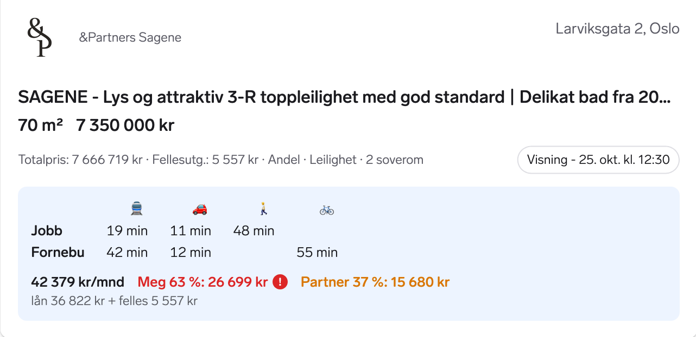
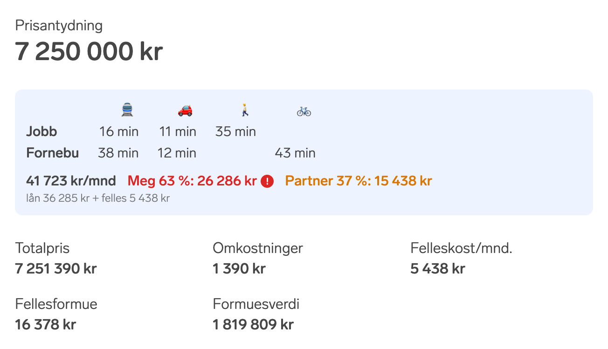
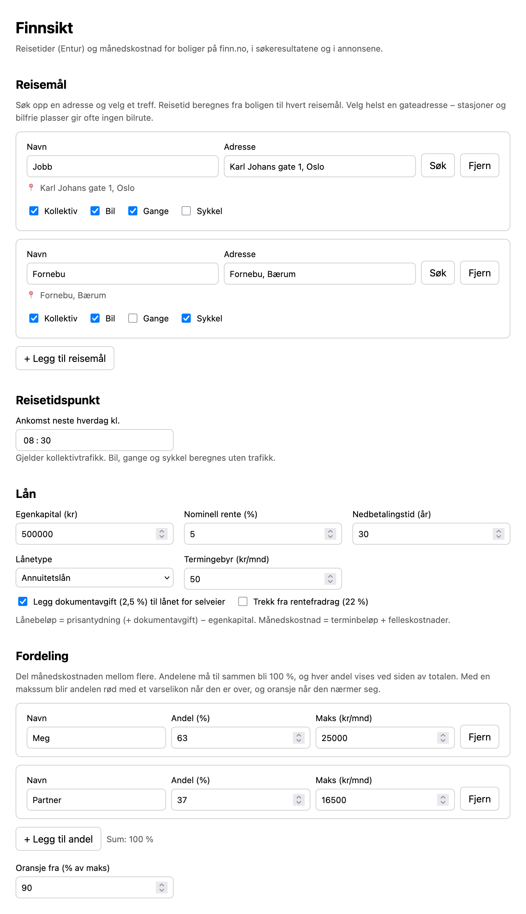

# Finnsikt

*finn* + *innsikt* (insight): a Firefox/Zen extension that adds a panel to every listing in the finn.no real-estate search (`/realestate/*/search.html`) and to each ad page (`/realestate/*/ad.html`), right below the asking price:

- **Travel times** from the listing to your own destinations by public transport, car, walking and bike, using [Entur](https://developer.entur.org/). Hover a time for details, such as the transit lines used.
- **Monthly cost**: the loan payment plus fellesutgifter, optionally split between several people ("Meg 63 %: 26 699 kr · Partner 37 %: 15 680 kr"), each split shown next to the total.

It also adds the travel times to every job in the job search (`/job/search`) and to each job ad (`/job/ad/<id>`), below the key facts. On job pages the times go the other way: from your places (such as home) to the job. Where the panel is narrow, as in the job search's grid view, only public transport and walking are shown; hover the panel to see every mode.

On a search result card, where "Meg" is over their max and "Partner" is close to it:



On an ad page, below the asking price:



## Setup

Node.js and pnpm versions are pinned in `mise.toml`. With [mise](https://mise.jdx.dev) installed:

```sh
mise install      # Node 26.12.0 and pnpm 12.14.0
pnpm install
pnpm build        # → dist/
pnpm test         # unit tests
pnpm lint         # typecheck + web-ext lint
```

Without mise, install Node 26.12.0 and run `npm install -g pnpm@12.14.0` first.

### Run during development

```sh
pnpm dev
```

This rebuilds on change and starts Zen in a fresh, temporary profile with the extension loaded as a temporary add-on, opened on a finn.no search.

| Script | Browser | Profile |
| --- | --- | --- |
| `pnpm dev` | Zen | new temporary profile each run |
| `pnpm dev:persist` | Zen | `.web-ext-profile/zen`, kept between runs |
| `pnpm dev:twilight` | Zen Twilight (nightly) | new temporary profile each run |
| `pnpm dev:twilight:persist` | Zen Twilight | `.web-ext-profile/twilight`, kept between runs |

The `:persist` variants keep your extension settings, the travel-time cache, finn.no logins and everything else between runs. Delete the folder to start over. For Firefox, run `node build.mjs --watch --run --browser=firefox` (add `--persist` to keep the profile).

### Use it in your everyday browser

The scripts above can't attach to a browser that is already running, so they always start a separate profile. To use the extension in the Zen or Zen Twilight you normally use:

1. Once: open `about:config` and set `xpinstall.signatures.required` to `false`. This lets the browser install the unsigned extension.
2. Run `pnpm addon:zen` or `pnpm addon:twilight`. This builds `web-ext-artifacts/finnsikt.xpi` and opens it in that browser, which asks you to add the extension.

After changing the code, run the same command again to install over the old version. Your settings and cache are kept.

For quicker iteration you can load it temporarily instead:

1. Run `pnpm watch`.
2. Open `about:debugging#/runtime/this-firefox`, click *Load Temporary Add-on…* and pick `dist/manifest.json`.
3. Click *Reload* there after each change.

A temporary add-on is removed when the browser restarts, but its settings are kept for the next time you load it.

If the `addon:` scripts can't open the browser, run `pnpm package` and install the `.xpi` from `about:addons` → ⚙ → *Install Add-on From File…*.

Regular Firefox release builds ignore that pref, so they need the version published on addons.mozilla.org.

## Settings

Click the toolbar icon to open the settings. If the extension asks for access to finn.no and api.entur.io, click **Gi tilgang**.



- **Reisemål**: search for an address and pick a result, then choose which travel modes to show. Pick a street address where you can: stations and car-free squares often have no car route.
  - **Vis på** chooses where a place is shown. On *Boliger* the time is from the home to the place, and on *Jobber* from the place to the job, so add your home here and tick only *Jobber*. Places added before this setting existed are shown on *Boliger* only.
- **Reisetidspunkt**: public transport times are for arriving by this time on the next weekday, at the place for homes and at the job for jobs. Car, walk and bike times assume no traffic.
- **Lån**: egenkapital, interest rate, loan term, annuity or serial loan, termingebyr, and two optional adjustments:
  - add 2.5 % dokumentavgift to the loan for selveier listings
  - subtract the 22 % interest tax deduction
- **Fordeling**: split the monthly cost between several people. Each split has a name, a percentage and an optional max per month. The splits must add up to 100 % before they are shown on the cards.
  - Over its max, a split turns red with a warning icon. Hover it to see by how much.
  - Close to its max, a split turns orange. "Oransje fra" sets what counts as close (default 90 % of the max).

The loan is based on **prisantydning**, not totalpris. Totalpris includes fellesgjeld, which fellesutgifter already pays for:

```
lånebeløp     = prisantydning (+ dokumentavgift) − egenkapital
månedskostnad = terminbeløp (+ termingebyr − rentefradrag) + fellesutgifter
```

New-build projects that only list a price range use the lowest price, shown as "fra".

## How it works

- `src/content.ts` watches the page and fetches its data from finn.no's own `.data` endpoint (`…/search.html.data?<query>` or `…/ad.html.data?finnkode=…`). That data is React Router's turbo-stream format, decoded in `src/lib/turbo-stream.ts`, and gives the coordinates and prices.
  - On the search page it adds a panel to each `article.sf-search-ad`.
  - On an ad page it adds one panel after the asking price (`[data-testid="pricing-incicative-price"]`).
  - If the data can't be loaded, it reads the prices from the page text and geocodes the address instead.
- The job search isn't a React Router app, so on `/job/search` the content script fetches the same JSON the page uses itself (`/job/job-search-page/api/unified-search/SEARCH_ID_JOB_FULLTIME?<query>`) and adds a travel-only panel to each `article.job-card-article__list`. Cards missing from that data, such as the paid placement, are geocoded from their location text.
- On a job ad (`/job/ad/<id>`) the coordinates come from the page's own map link (`a[href*="/map?adId=…"]`), so nothing extra is fetched. The panel goes after the key facts (Søknadsfrist, hjemmekontor, …).
- `src/background.ts` asks Entur's journey planner for all destinations and modes of a listing in one GraphQL request (for jobs with each place as the start and the job as the end), with at most 3 requests running at once. Results are cached in `storage.local` for 14 days.
- Settings live in `storage.sync`, and open finn.no tabs update right away when they change.

The extension depends on finn.no's internal data endpoint and CSS class names, so a finn.no redesign may break it.

## Publishing to addons.mozilla.org

The listing text, category, license and reviewer notes are in `amo-metadata.json`. The privacy policy is in [PRIVACY.md](PRIVACY.md).

1. Bump `version` in `static/manifest.json`. Every upload needs a new version.
2. Run `pnpm sign` with your [AMO API credentials](https://addons.mozilla.org/developers/addon/api/key/):

   ```sh
   WEB_EXT_API_KEY=... WEB_EXT_API_SECRET=... pnpm sign
   ```

   This builds `dist/`, zips the source code with `pnpm source` (every file jj tracks), and submits both to the listed channel.
3. The first time, finish the listing in the AMO Developer Hub: paste `PRIVACY.md` into the privacy policy field, and add a support email or website. The API can't set those.

Because the code is bundled with esbuild, AMO reviewers rebuild it from the source zip and compare the result with the submitted package. They follow the build steps under [Setup](#setup), which `amo-metadata.json` repeats for them.

### Building for review

```sh
mise install
pnpm install --frozen-lockfile
pnpm build
```

The extension is then in `dist/`. Node 26.12.0 and pnpm 12.14.0 are required; both are pinned in `mise.toml`, and pnpm also in `package.json`.

## License

[MIT](LICENSE)
